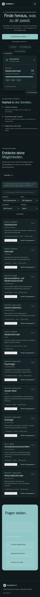
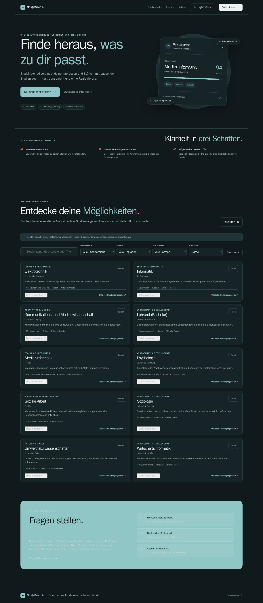

# StudyMatch AI

> **Version 1.4 · Studienorientierung mit 37 quellenbasierten Profilen**

StudyMatch AI hilft Schülerinnen und Schülern, Studienideen anhand von Interessen, Stärken und
Präferenzen zu entdecken. Das Interface ist bewusst ruhig, klar und mobil nutzbar gestaltet: Eine
saubere visuelle Hierarchie, nachvollziehbare Interaktionen und gut lesbare Kontraste stehen vor
dekorativen Effekten. Die Website bleibt statisch, ohne Registrierung, Tracking, Backend oder
KI-API und ist für GitHub Pages geeignet.

> **Wichtig:** Ein Match-Score ist eine Orientierung innerhalb der eingebundenen Auswahl. Er ist
> keine wissenschaftlich validierte Prognose, Zulassungsberatung oder Erfolgsgarantie.

## Live-Demo

[GitHub-Pages-Demo öffnen](https://ensar2222b.github.io/Studymatch-ai/)

## Aktuelle Ansichten





## Funktionen

- 11 verständliche Finder-Fragen mit „Ich bin mir unsicher“
- Lokale Speicherung von Fortschritt, Antworten, Favoriten und Theme
- Gewichtetes Matching mit Score, passenden Merkmalen und möglichen Herausforderungen
- Ergebnis-Dashboard mit offiziellen Quellenlinks je Profil
- Explorer mit Suche nach Studiengang, Hochschule und Beschreibung
- Filter nach Fachbereich, Region und Studienform
- Sortierung nach Name, Fachbereich oder Hochschule
- Detailansicht und Favoriten für Studiengänge
- Vergleich von maximal drei Studiengängen
- 37 redaktionelle Studienprofile mit Inhalten, Anforderungen, Fachanteilen, Berufsfeldern und ähnlichen Richtungen
- Light-/Dark-Mode und responsive mobile Navigation

## Design-Philosophie und Designsystem

Das Redesign orientiert sich an etablierten Prinzipien aus Produktdesign und Accessibility:
klare Informationshierarchie, vorhersehbare Navigation, großzügige Touchflächen, sichtbare
Fokuszustände und reduzierte Bewegung. StudyMatch AI verwendet keine Emojis als UI-Icons, keine
externen Fonts und keine überladenen Verläufe oder Glow-Effekte.

| Bereich | Entscheidung |
| --- | --- |
| Farben | Dunkelblau/Petrol als Primärfarbe, neutrales Hellgrau als Fläche, zurückhaltendes Terrakotta als Akzent |
| Typografie | Systemschrift-Stack ohne externe Requests; starke Überschriften, gut lesbare Fließtexte |
| Komponenten | Dezente Rahmen, kleine bis mittlere Radien, zurückhaltende Schatten und klare Zustände |
| Interaktion | Sichtbare `:focus-visible`-Zustände, mindestens 40–46 px große Bedienelemente, reduzierte Bewegung |
| Responsive Layouts | Mobile Navigation, einspaltige Karten und Explorer-Filter für kleine Viewports; Breakpoints bei 800, 930 und 480 px |

Die Gestaltung wurde für 390 px, 768 px und 1440 px ausgelegt. Geschäftslogik, Datenmodell,
Matching, Favoriten, Vergleich und lokale Speicherung bleiben unverändert.

### UI/UX Refinement

Die nachfolgende Präzisierung fokussiert die mobile Nutzung, ohne die Markenidentität neu zu
definieren. Der Hero ist auf kleinen iPhones kompakter, die Beschreibung kürzer und die
Beispielkarte als nicht-personalisiertes Beispielprofil gekennzeichnet. Die frühere Zahlenleiste
wurde durch drei Schritte zur Funktionsweise ersetzt. Dadurch bleibt die Startseite informativ,
ohne unnötige Zahlen oder große vertikale Abstände.

## Verifizierte Datenquellen

Die aktuelle Auswahl besteht aus 37 redaktionell kompakten Profilen, die auf offiziellen
Hochschulseiten basieren. Zehn Quellen waren bereits Bestandteil der vorherigen Version; 30
weitere Quellen sind in `programmes-catalog.js` dokumentiert. Die Quellenliste wurde am
**16. November 2026** zusammengestellt. StudyMatch AI übernimmt keine vollständigen Datenbanken
und zeigt keine NC-Werte, Gehälter oder Zulassungsvoraussetzungen.

Die neue Datenbasis umfasst unter anderem:

| Bereich | Beispiele offizieller Quellen |
| --- | --- |
| Technik und Informatik | TUM, RWTH Aachen, Universität Hamburg, TU Dresden, Ruhr-Universität Bochum, OVGU Magdeburg |
| Wirtschaft und Schnittstellen | Universität zu Köln, Universität Passau, KIT, TU Dortmund |
| Natur und Umwelt | Universität Freiburg, Universität Heidelberg, Universität Bonn, Universität Bremen, Leuphana, Universität Rostock, Universität Jena |
| Gesellschaft, Gesundheit und Bildung | LMU München, Universität Leipzig, HAW Hamburg, Hochschule München, TH Köln, Universität Potsdam |
| Medien, Kommunikation und Gestaltung | TH Köln, Universität Leipzig, Universität Münster, TU Berlin, HTW Berlin |

Die Links werden ausschließlich als Quellenverweise verwendet. Inhalte, Anforderungen und
Fachanteile sind kompakte Orientierungstexte; „unklar“ bedeutet, dass die App keine belastbare
Aussage zum Anteil macht. Für aktuelle Modulpläne, Fristen und verbindliche Voraussetzungen ist
immer die jeweilige Hochschule maßgeblich.

| Studiengang | Hochschule | Offizielle Quelle |
| --- | --- | --- |
| Medieninformatik | TH Köln | [Studiengangsseite](https://www.th-koeln.de/medieninformatik_ba) |
| Informatik | TU Dortmund | [Studiengangsseite](https://cs.tu-dortmund.de/en/studium/studiengaenge/bachelor-informatik/?tabindex=1) |
| Wirtschaftsinformatik | Universität zu Köln | [Studiengangsseite](https://wim.uni-koeln.de/de/studium/bsc-wirtschaftsinformatik) |
| Umweltnaturwissenschaften | Universität Freiburg | [Studiengangsseite](https://uni-freiburg.de/studium/studienangebot/studiengang/757/) |
| Elektrotechnik | Hochschule Esslingen | [Studiengangsseite](https://www.hs-esslingen.de/mobilitaet-und-technik/studienangebote/bachelorstudiengaenge/elektrotechnik-beng) |
| Psychologie | Universität Hamburg | [Studiengangsseite](https://www.psy.uni-hamburg.de/studium-neu/studiengaenge/bsc-psychologie-ab-wise-20-21.html) |
| Soziale Arbeit | TH Köln | [Studiengangsseite](https://www.th-koeln.de/studium/soziale-arbeit-bachelor_259.php) |
| Soziologie | Universität Bremen | [Studiengangsseite](https://www.uni-bremen.de/studium/orientieren-bewerben/studienangebot/dbs/study/soziologie-bachelor) |
| Kommunikations- und Medienwissenschaft | Universität Leipzig | [Studiengangsseite](https://www.cmgt.uni-leipzig.de/studium/ba_kmw.html?L=986) |
| Lehramts-Bachelor | Universität Potsdam | [Studiengangsseite](https://www.uni-potsdam.de/de/studium/studienangebot/lehramt/bachelor) |

Studieninhalte, Berufsfelder und Herausforderungen sind zusammenfassende Orientierungstexte. Für
aktuelle Details, Bewerbungsfristen, Studienordnungen und Voraussetzungen ist ausschließlich die
jeweilige Hochschule maßgeblich.

## Matching-Algorithmus

Der Finder vergleicht Antworten mit Merkmalen der Profile. Höhere Gewichte liegen auf Interessen,
Stärken und Berufszielen; Region und Studienform sind Präferenzen. Unsichere Antworten werden
übersprungen und nicht als negative Antwort gewertet.

| Dimension | Gewicht |
| --- | ---: |
| Interessen | 2,0 |
| Schulfächer | 1,5 |
| Stärken | 2,0 |
| Kreativität | 1,5 |
| Analytisches Denken | 1,5 |
| Berufsziel | 2,0 |
| Arbeitsumgebung | 1,5 |
| Mathematik / Programmierung | 1,0 |
| Studienform | 1,0 |
| Region | 0,75 |

Es gibt bewusst keine harten Zulassungs-Ausschlüsse, weil die App keine verbindliche
Zulassungsdatenbank ist. Ein niedriger Score bedeutet nicht, dass ein Studiengang ungeeignet ist.

## Lokal entwickeln

```bash
git clone https://github.com/ensar2222b/Studymatch-ai.git
cd Studymatch-ai
python3 -m http.server 8080
```

Dann [http://localhost:8080](http://localhost:8080) öffnen.

```bash
node --check app.js
node --test tests/matching.test.mjs
git diff --check
```

### Qualitätssicherung

Für das Redesign wurden Syntax- und Datenlogiktests sowie manuelle Browser-Flows für Finder,
Explorer, Filter, Favoriten, Vergleich, Theme und mobile Navigation durchgeführt. Zusätzlich
wurden horizontale Überläufe und sichtbare Fokuszustände in den Ziel-Viewports geprüft.

## Architektur und Datenschutz

Die Anwendung besteht aus `index.html`, `styles.css`, `programmes-catalog.js` und `app.js`;
`index.html` liegt im Repository-Root für GitHub Pages. Antworten und Favoriten werden ausschließlich mit
`localStorage` im Browser gehalten. Es gibt keine Cookies, Analyse-Skripte, Konten oder
Serverübertragung. Externe Links führen direkt zu den offiziellen Hochschulseiten.

## GitHub Pages

Nach dem Merge:

1. **Settings → Pages** öffnen.
2. **Deploy from a branch** auswählen.
3. Branch `main` und `/ (root)` speichern.
4. Die Demo unter `https://ensar2222b.github.io/Studymatch-ai/` öffnen.

## Einschränkungen und Roadmap

Die Profile sind redaktionell gepflegt und werden nicht automatisch mit Hochschulen synchronisiert.
Quellen müssen regelmäßig manuell geprüft werden; URL-Erreichbarkeit kann sich ändern. Der nächste
sinnvolle Schritt ist ein versionierter Datenpflegeprozess mit Änderungsdatum, Modulhandbuch-Links
und automatisierten Link-Checks. Eine sichere Advisor-Backend-Architektur bleibt Zukunftsmusik und
wird in dieser Version nicht implementiert.
