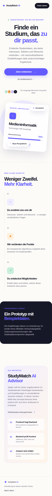

# StudyMatch AI

> **Version 1.1 · Statischer Studienorientierungs-Prototyp für Deutschland**

StudyMatch AI unterstützt Schülerinnen und Schüler dabei, erste Studienideen zu entdecken, die zu
ihren Interessen, Stärken und persönlichen Präferenzen passen könnten. Der Prototyp verbindet eine
hochwertige, responsive Oberfläche mit einem nachvollziehbaren Matching-Algorithmus.

> **Wichtig:** Die Studiengänge und Regionen in dieser Version sind ausdrücklich Beispieldaten.
> Sie sind keine offiziellen Hochschulangebote, keine Zulassungsberatung und kein Versprechen für
> einen Studienplatz.

## Live-Demo

Die für GitHub Pages vorgesehene URL lautet:

**[ensar2222b.github.io/Studymatch-ai](https://ensar2222b.github.io/Studymatch-ai/)**

Die Demo ist verfügbar, sobald der v1.1-Pull-Request gemerged und GitHub Pages für den Branch
`main` mit dem Ordner `/ (root)` aktiviert wurde.

## Vorschau

Desktop:


Mobil:



## Funktionen

| Bereich | Enthalten |
| --- | --- |
| Landingpage | Hero-Bereich, Navigation, Markenstil und klare Call-to-Actions |
| Studienfinder | Sieben Fragen zu Interessen, Stärken, Arbeitsweise, Lernstil, Mathe/Programmierung, Region und Studienform |
| Ergebnisse | Sortierte Studienideen, Score, Begründung, Berufsfelder und passende Antwortbereiche |
| Vergleich | Beliebig viele ausgewählte Studienideen in einer übersichtlichen Tabelle vergleichen |
| Responsive UI | Für Smartphone, Tablet und Desktop optimierte Layouts |
| Transparenz | Beispieldaten-Hinweise und Erklärung des Score-Modells |
| AI Advisor Konzept | Sicherheits- und Architekturkonzept für eine spätere Backend-Integration |

## Verwendete Technologien

- Semantisches HTML5
- Modernes CSS mit responsiven Breakpoints, Design Tokens und `prefers-reduced-motion`
- Vanilla JavaScript (ES6+)
- Google Fonts: DM Sans und Space Grotesk
- Keine Frameworks, kein Build-Schritt und keine kostenpflichtigen Dienste

## Lokal ausführen

```bash
git clone https://github.com/ensar2222b/Studymatch-ai.git
cd Studymatch-ai
python3 -m http.server 8080
```

Danach im Browser [http://localhost:8080](http://localhost:8080) öffnen. Für eine schnelle
Syntaxprüfung:

```bash
node --check app.js
```

## Matching-Algorithmus

Der Finder vergleicht die ausgewählte Antwort mit den Merkmalen jedes Studienprofils. Jede Dimension
hat ein Gewicht; die Summe passender Gewichte wird auf einen Prozentwert normiert:

| Dimension | Gewicht |
| --- | ---: |
| Interessen | 2,0 |
| Stärken | 2,0 |
| Arbeitsweise | 2,0 |
| Lernstil | 1,5 |
| Mathe/Programmierung | 1,5 |
| Region | 1,0 |
| Studienform | 1,0 |

Der Score ist damit eine nachvollziehbare Ähnlichkeitsanzeige innerhalb der Beispieldaten. Er ist
keine wissenschaftliche Eignungsdiagnostik. Die Ergebnisbegründung erklärt die Rolle der
Studienprofile; sie wird in dieser Version nicht von einer echten KI generiert.

## Datenschutz und lokale Datenspeicherung

- Der Prototyp sendet Antworten nicht an einen Server.
- Antworten werden nur während der aktuellen Browser-Sitzung im JavaScript-Speicher gehalten.
- Es werden keine Cookies, kein `localStorage` und keine Analyse- oder Werbe-Tracker verwendet.
- Beim Neuladen oder Schließen der Seite gehen Antworten verloren.
- Die eingebundenen Google Fonts stellen eine externe Verbindung zu Google her. Für einen
  vollständig selbstständigen Betrieb können die Schriftdateien später lokal eingebunden werden.
- Eine spätere KI-Anbindung muss Datenminimierung, Einwilligung, Löschkonzept, Transportverschlüsselung
  und serverseitige Geheimnisverwaltung berücksichtigen.

## StudyMatch AI Advisor

Der spätere Advisor soll Rückfragen zu Studienideen beantworten und Empfehlungen erklären. Er wird
nicht direkt aus dem Browser mit einem KI-Anbieter sprechen.

```text
Browser
  │  HTTPS + validierter Request
  ▼
Eigener Backend-Endpunkt
  ├─ Authentifizierung / Rate Limit / Eingabevalidierung
  ├─ Datenminimierung und Protokollierungsregeln
  ├─ Kuratierter Studienprofil-Kontext
  └─ Anbieteradapter mit serverseitigem API-Schlüssel
       ▼
   KI-Modell oder austauschbarer lokaler Dienst
```

Geplante Sicherheitsregeln:

1. API-Schlüssel ausschließlich in serverseitigen Secrets oder einer Secret-Management-Lösung.
2. Keine personenbezogenen Antworten dauerhaft speichern, sofern es nicht ausdrücklich erforderlich
   und transparent erklärt ist.
3. Antworten mit Quellen, Unsicherheiten und dem Hinweis auf eigene Recherche ausgeben.
4. Eingaben und Ausgaben validieren, missbräuchliche Nutzung begrenzen und Kostenlimits setzen.
5. Anbieteradapter so kapseln, dass der statische Prototyp ohne KI weiterhin funktioniert.

## Projektstruktur

```text
.
├── index.html
├── styles.css
├── app.js
├── AGENTS.md
├── README.md
└── .github/
    └── copilot-instructions.md
```

## GitHub Pages

`index.html` liegt direkt im Repository-Root. Für die Veröffentlichung:

1. Repository auf GitHub öffnen.
2. **Settings → Pages** auswählen.
3. **Deploy from a branch** wählen.
4. Branch `main` und Ordner `/ (root)` speichern.

## Einschränkungen

- Die Profildaten sind klein und redaktionell beispielhaft.
- Es gibt keine offizielle Hochschul-, Studiengangs- oder Zulassungsdatenbank.
- Der Algorithmus berücksichtigt keine Noten, Fristen, Kosten, Barrierefreiheit oder individuellen
  Lebenssituationen.
- Der Score ersetzt keine Studienberatung und keine Prüfung aktueller Hochschulinformationen.

## Roadmap

- Verifizierte, versionierte Studiengangsdaten mit Quellen und Aktualisierungsprozess
- Filter für Abschlussart, Zulassung, Kosten, Barrierefreiheit und Studienort
- Ausführlichere Ergebniserklärung und gespeicherter Vergleich auf Wunsch der Nutzerinnen und Nutzer
- Automatisierte Browser- und Accessibility-Tests
- Sicheres Backend für den **StudyMatch AI Advisor**
- Mehrsprachige Inhalte und barrierearme, lokal eingebundene Schriftarten

## Lizenz

Für den Prototyp ist derzeit keine separate Open-Source-Lizenz festgelegt. Vor einer öffentlichen
Weiterverwendung sollte eine passende Lizenz ergänzt werden.
