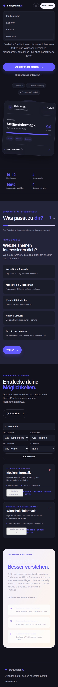

# StudyMatch AI

> **Version 1.2 · Moderne Studienorientierung für Schülerinnen und Schüler in Deutschland**

StudyMatch AI ist eine statische EdTech-Plattform, die erste Studienideen aus Interessen,
Stärken und persönlichen Präferenzen ableitet. Die Anwendung funktioniert ohne Registrierung,
Tracking oder externe Datenbank und bleibt vollständig für GitHub Pages geeignet.

> **Transparenz:** Alle Studiengänge, Inhalte und Regionen sind klar gekennzeichnete Demo-Profile.
> Sie sind keine offiziellen Hochschulangebote, keine Zulassungsberatung und keine wissenschaftlich
> validierte Prognose.

## Demo

[GitHub-Pages-Demo öffnen](https://ensar2222b.github.io/Studymatch-ai/)

Die Demo ist verfügbar, sobald der v1.2-Pull-Request gemerged und GitHub Pages für `main` mit
`/ (root)` aktiviert wurde.

## Funktionen

| Bereich | Beschreibung |
| --- | --- |
| Premium UI | Light-/Dark-Mode, Systempräferenz, mobile Navigation, responsive Karten und dezente Animationen |
| Studienfinder | 11 verständliche Fragen zu Interessen, Fächern, Stärken, Kreativität, Analyse, Berufszielen, Arbeitsumgebung, Mathe, Programmierung, Studienform und Region |
| Fortschritt | Antworten und aktueller Schritt werden lokal gespeichert und können fortgesetzt werden |
| Dashboard | Persönliche Zusammenfassung, Top-Matches, Score, Übereinstimmungen, Herausforderungen und Berufsfelder |
| Explorer | Suche, Fachbereich-, Regionen- und Studienformfilter, Sortierung und Detailansichten |
| Favoriten | Demo-Profile lokal speichern und wieder entfernen |
| Vergleich | Bis zu drei Studiengänge auf einer responsiven Tabelle vergleichen |
| Advisor-Konzept | Sichere Architektur für eine spätere Backend-Anbindung, ohne echte KI in v1.2 |

## Vorschau




Die Screenshots dokumentieren die responsive Designrichtung; die interaktiven Funktionen sind im
lokalen Browser testbar.

## Technologien und Architektur

- Semantisches HTML5, CSS Custom Properties und Vanilla JavaScript
- Keine Frameworks, kein Build-Schritt, keine kostenpflichtigen Dienste
- `index.html` als Einstiegspunkt im Repository-Root
- `app.js` enthält Fragen, Demo-Profile, UI-Zustände, Matching, Explorer und lokale Persistenz
- `styles.css` enthält Design Tokens, Light-/Dark-Theme, Komponenten und responsive Breakpoints
- `localStorage` speichert ausschließlich Quiz-Fortschritt, Antworten, Favoriten und Theme-Auswahl

## Lokal entwickeln

```bash
git clone https://github.com/ensar2222b/Studymatch-ai.git
cd Studymatch-ai
python3 -m http.server 8080
```

Danach [http://localhost:8080](http://localhost:8080) öffnen. Für Syntax- und Diff-Prüfungen:

```bash
node --check app.js
git diff --check
```

## Matching-Algorithmus

Jede Antwort wird mit Merkmalen des jeweiligen Demo-Profils verglichen. Interessen, Stärken und
Berufsziel erhalten höhere Gewichte; Region und Studienform sind optionale Präferenzen. Antworten
wie „Ich bin mir unsicher“ werden nicht negativ bewertet und aus dem Nenner des Scores
ausgenommen. Der Score ist eine normalisierte Ähnlichkeitsanzeige innerhalb der Demo-Profile.

| Dimension | Gewicht |
| --- | ---: |
| Interessen | 2,0 |
| Schulfächer | 1,5 |
| Stärken | 2,0 |
| Kreativität | 1,5 |
| Analytisches Denken | 1,5 |
| Berufsziel | 2,0 |
| Arbeitsumgebung | 1,5 |
| Mathematik | 1,0 |
| Programmierung | 1,0 |
| Studienform | 1,0 |
| Region | 0,75 |

In v1.2 gibt es keine fachlichen Ausschlusskriterien, weil die Anwendung keine verbindlichen
Studienvoraussetzungen kennt. Die Studienform wird als Präferenz und nicht als Zusage interpretiert.
So entstehen keine unzulässigen Aussagen über Zulassung, NC oder Studienerfolg.

## Explorer-Daten und Einschränkungen

Die sechs Profile in `app.js` sind redaktionelle Demodaten. Sie enthalten keine konkreten
Hochschulen, NC-Werte, Gehälter, Zulassungsvoraussetzungen oder offiziellen Links. Typische Inhalte
und Berufsfelder sind als allgemeine Orientierung formuliert und müssen vor einer echten
Studienentscheidung mit offiziellen Hochschulquellen geprüft werden.

## Datenschutz

- Antworten verlassen den Browser nicht.
- Es werden keine Cookies, Tracker, Analyse-Skripte oder Konten verwendet.
- `localStorage` enthält nur den aktuellen Quiz-Fortschritt, Favoriten und Theme-Auswahl.
- Daten können über „Neu starten“ gelöscht werden; Browserdaten lassen sich zusätzlich über die
  Browser-Einstellungen entfernen.
- Google Fonts werden aktuell extern geladen. Für einen vollständig selbstständigen Betrieb können
  die Schriftdateien lokal eingebunden werden.

## StudyMatch AI Advisor

Der spätere Advisor soll Rückfragen stellen, Studiengänge erklären und Alternativen begründen.
Die aktuelle Anwendung enthält keine echte KI-Funktion. Die sichere Zielarchitektur ist:

```text
Browser → eigener HTTPS-Backend-Endpunkt → Validierung / Rate Limit / Datenminimierung
        → kuratierter Profil-Kontext → serverseitiger Anbieteradapter → KI-Dienst
```

API-Schlüssel bleiben ausschließlich serverseitig. Antworten sollen Unsicherheiten und Quellen
sichtbar machen; personenbezogene Daten werden minimiert und nicht standardmäßig dauerhaft
gespeichert. Der statische Finder muss auch ohne diesen Dienst vollständig funktionieren.

## GitHub Pages

1. Pull Request gegen `main` prüfen und mergen.
2. **Settings → Pages → Deploy from a branch** öffnen.
3. Branch `main` und Ordner `/ (root)` auswählen.
4. `https://ensar2222b.github.io/Studymatch-ai/` öffnen.

## Roadmap für v1.3

- Verifizierte Studiengangsprofile mit Quellen, Aktualisierungsdatum und offiziellen Links
- Lokale Schriftdateien und automatisierte Accessibility-Tests
- Detailseiten mit echten, redaktionell geprüften Daten
- Sichere Backend-Schnittstelle für den StudyMatch AI Advisor
- Export eines persönlichen Vergleichs als datenschutzfreundliches Dokument

## Lizenz

Für den Prototyp ist derzeit keine separate Open-Source-Lizenz festgelegt.
